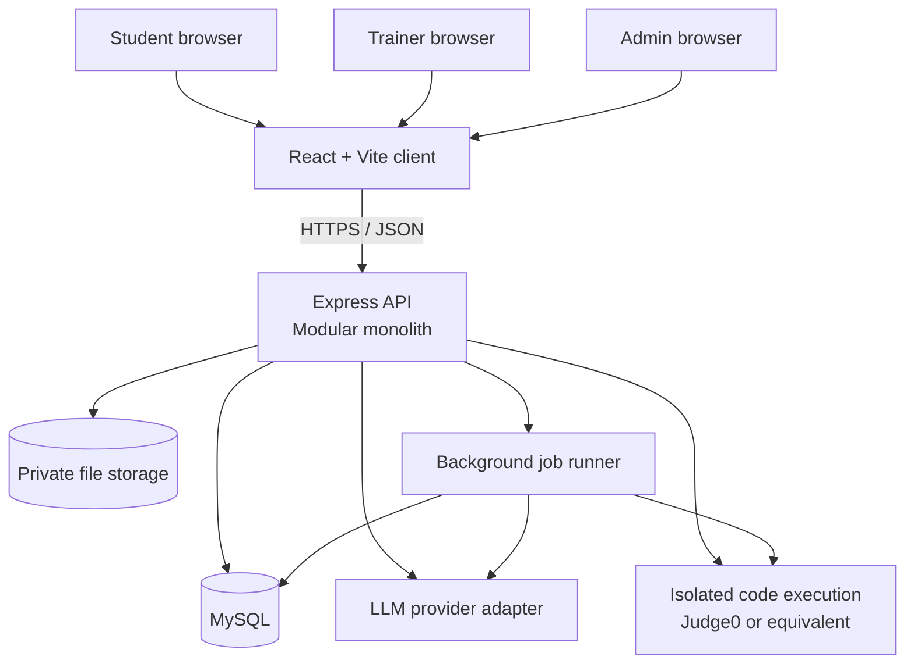
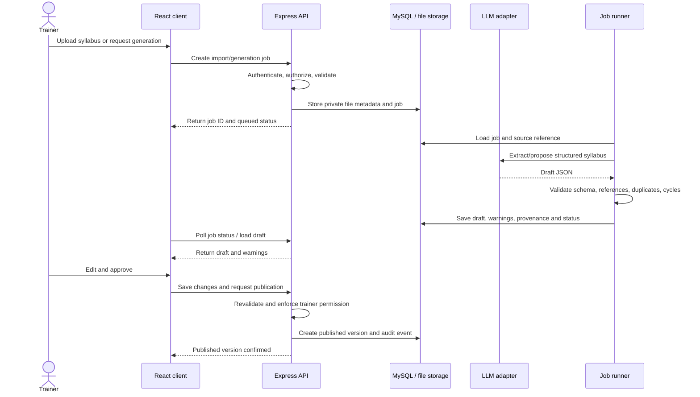
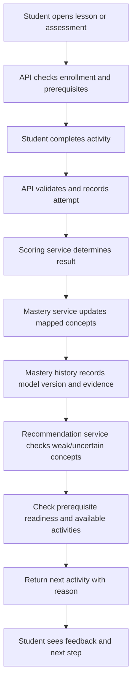
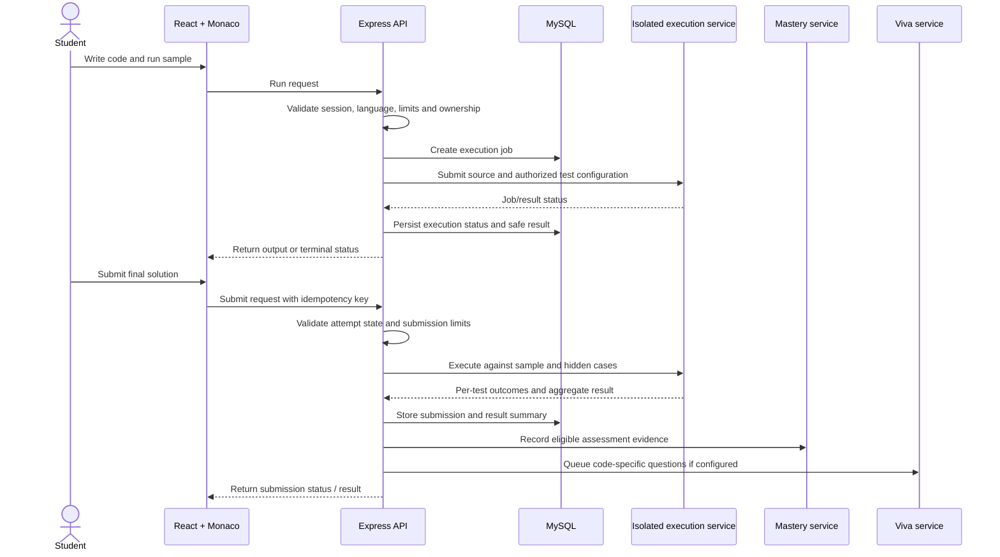
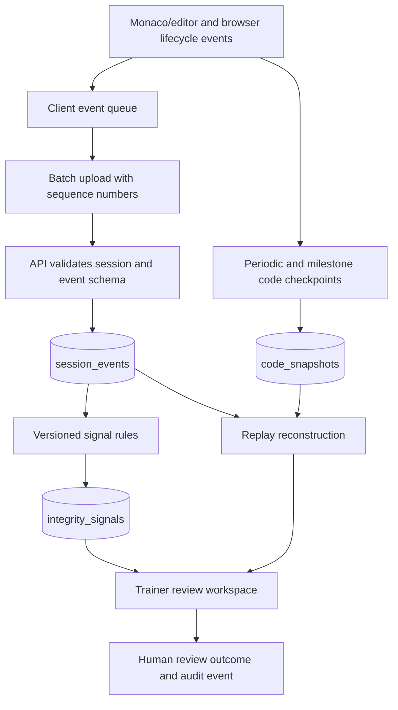
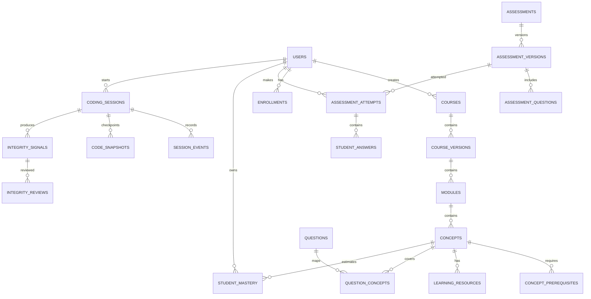
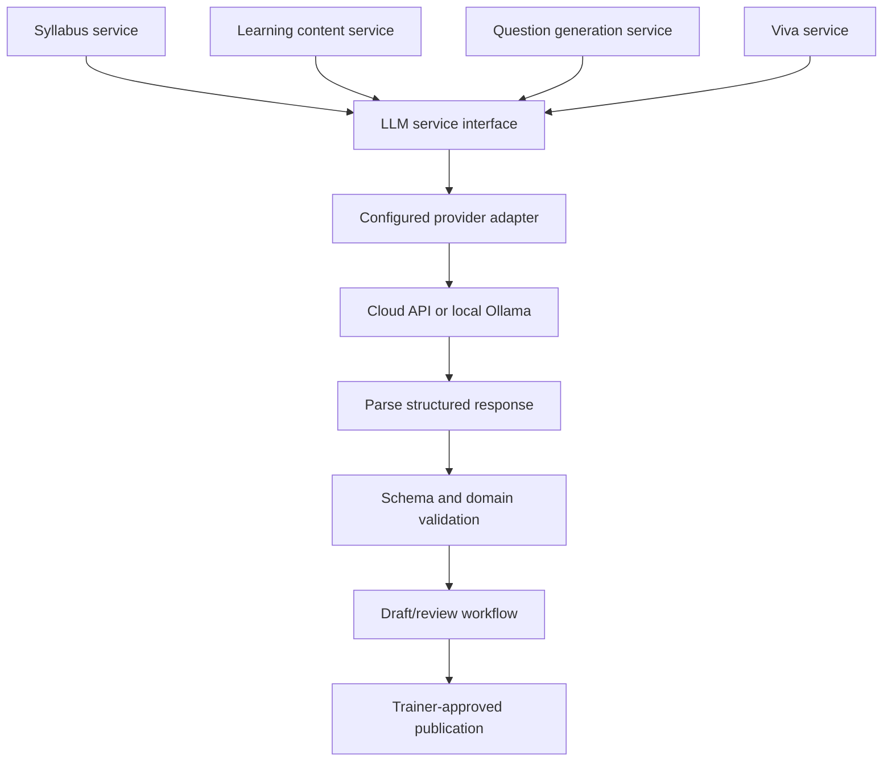
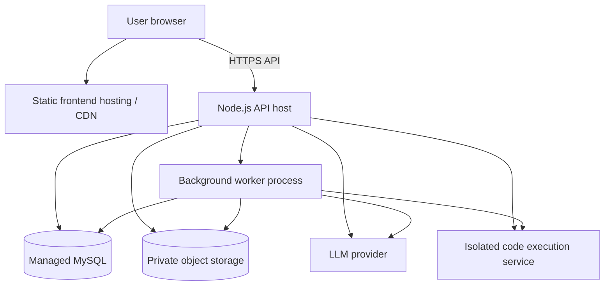

# System Architecture

1. Purpose
This document describes the proposed technical architecture for Pathwise, including application boundaries, core services, data flow, persistence, integrations, security controls, and delivery strategy.
It complements the project's PRD and frontend_design.md:
- PRD: defines product scope, functional requirements, priorities, and acceptance criteria.
- Frontend design: defines the user interface, interaction patterns, and visual system.
- Architecture: defines how the system is organized and how its components communicate.
The initial implementation should be a modular monolith, not a collection of microservices. This keeps local development and deployment manageable while preserving clear service boundaries for future scaling.
2. Architecture principles
1. Backend is authoritative. Scores, hidden tests, permissions, mastery updates, prerequisite checks, publication, and integrity-review records are enforced by the server.
2. One deployable application first. Keep the main API in a modular Express application. Isolate code execution through a dedicated execution provider/service.
3. AI creates drafts, not truth. Model output is untrusted, schema-validated, tested where applicable, and trainer-approved before publication.
4. Providers are replaceable. Hide LLM and code-execution providers behind small adapters.
5. Keep the core deterministic. Use ordinary application logic for scoring, prerequisite validation, test execution orchestration, mastery updates, and recommendations. Use LLMs only where language generation or interpretation is useful.
6. Preserve evidence and versions. Link attempts to the exact content and assessment versions used.
7. Privacy by design. Record only disclosed, assessment-relevant session events. Integrity signals support human review and do not automatically penalize students.
8. Build the end-to-end learning loop first. Deliver a small reliable flow before advanced analytics, voice viva, RAG, or repository evaluation.
3. Selected technology baseline
The following is the recommended implementation baseline for this project, taking account of the project's JavaScript-only preference and MySQL setup.
Layer	Technology	Responsibility
Web client	React + Vite, JavaScript	Student, trainer, and admin interfaces
Styling and components	Tailwind CSS, shadcn/ui, Lucide	Responsive, consistent UI
Routing	React Router	Client-side navigation
Charts	Recharts	Mastery and assessment trends
Code editor	Monaco Editor	Browser-based coding assessments
API server	Node.js + Express, JavaScript	Business logic, authorization, orchestration
Validation	Zod	Validate request bodies and structured model output
Database	MySQL using mysql2	Relational application data and audit history
Authentication	Server-side sessions + bcrypt	Login, session lifecycle, password hashing
LLM integration	Provider adapter	Syllabus extraction/generation, content drafts, viva generation/evaluation
Code execution	Judge0 or equivalent isolated service	Compile and execute untrusted code
File storage	Private object storage or protected server storage	Syllabus files and permitted attachments
Background work	Database-backed jobs initially; add a queue if needed	Long-running AI, extraction, and execution workflows
Source control	Git + GitHub	Version control and collaboration
Deployment	Static frontend host + Node-compatible API host + managed MySQL	Production hosting

Important: The PRD lists Supabase/PostgreSQL and TypeScript as one possible stack. This architecture chooses MySQL and JavaScript to match the project's current implementation preferences. Do not mix Supabase Auth/RLS assumptions into this design unless the stack decision is explicitly changed.
Avoid adding Redis, Kafka, Kubernetes, a Python service, or separate microservices at MVP stage unless measured requirements justify them.
4. System context

Trust boundaries
- The browser is untrusted. It must never decide final scores, role permissions, mastery values, or publication status.
- The Express API is the application trust boundary. It validates identity, permissions, request schemas, and business rules.
- The database is private and is never accessed directly by the browser.
- The LLM provider receives only the minimum context needed for the task. Its output is untrusted.
- The execution service handles untrusted source code and must enforce resource and isolation limits.
- Private files, answer keys, reference solutions, and hidden test cases must not be publicly accessible.
5. Container and repository layout
Keep the repository to the project's three top-level folders: client, server, and docs.
pathwise/
├── client/
│   ├── public/
│   ├── src/
│   │   ├── app/
│   │   │   ├── App.jsx
│   │   │   ├── router.jsx
│   │   │   └── providers.jsx
│   │   ├── components/
│   │   │   ├── layout/
│   │   │   ├── ui/
│   │   │   ├── feedback/
│   │   │   ├── courses/
│   │   │   ├── assessments/
│   │   │   ├── editor/
│   │   │   ├── mastery/
│   │   │   └── replay/
│   │   ├── pages/
│   │   │   ├── auth/
│   │   │   ├── student/
│   │   │   ├── trainer/
│   │   │   └── admin/
│   │   ├── hooks/
│   │   ├── services/
│   │   │   └── apiClient.js
│   │   ├── utils/
│   │   └── styles/
│   └── package.json
├── server/
│   ├── src/
│   │   ├── app.js
│   │   ├── server.js
│   │   ├── config/
│   │   ├── middleware/
│   │   ├── routes/
│   │   ├── modules/
│   │   │   ├── auth/
│   │   │   ├── users/
│   │   │   ├── courses/
│   │   │   ├── syllabus/
│   │   │   ├── concepts/
│   │   │   ├── content/
│   │   │   ├── questions/
│   │   │   ├── assessments/
│   │   │   ├── mastery/
│   │   │   ├── recommendations/
│   │   │   ├── coding/
│   │   │   ├── sessions/
│   │   │   ├── integrity/
│   │   │   ├── viva/
│   │   │   ├── analytics/
│   │   │   └── audit/
│   │   ├── integrations/
│   │   │   ├── llm/
│   │   │   ├── codeExecution/
│   │   │   └── fileStorage/
│   │   ├── jobs/
│   │   ├── db/
│   │   │   ├── pool.js
│   │   │   ├── migrations/
│   │   │   └── seeds/
│   │   ├── utils/
│   │   └── appErrors/
│   ├── tests/
│   └── package.json
└── docs/
    ├── PRD.md
    ├── frontend_design.md
    ├── architecture.md
    └── api-contracts.md
Adapt this layout to the current repository instead of deleting or rewriting working code without need.
Backend module structure
A module should generally separate:
- *.routes.js: route definitions and middleware.
- *.controller.js: HTTP input/output handling.
- *.service.js: business rules and orchestration.
- *.repository.js: database queries.
- *.schema.js: request/response validation.
- *.test.js: module tests where practical.
Keep controllers thin. Do not place SQL, LLM prompts, scoring rules, or mastery logic directly inside route handlers.
6. Backend module responsibilities
Module	Responsibilities	Must not do
Auth and users	Login/logout, session management, profiles, roles	Trust client-supplied roles
Courses	Course lifecycle, enrollment, course versioning	Publish unreviewed generated content
Syllabus	Upload processing, text extraction, structure validation	Treat model output as approved curriculum
Concepts	Modules, learning objectives, prerequisite edges, cycle checks	Allow cyclic prerequisite graphs
Content	Learning resources, drafts, content versions, review states	Return trainer-only drafts to students
Questions	Question bank, concept mapping, answer/rubric protection	Expose answer keys or hidden cases
Assessments	Blueprints, attempts, timers, submission rules, scoring	Trust client-calculated marks
Mastery	Per-student/per-concept estimates and history	Use integrity signals as direct negative mastery evidence
Recommendations	Eligible concepts, prerequisite readiness, next activity and reason	Recommend content the student cannot access
Coding	Sessions, source versions, run/submit orchestration	Execute arbitrary code inside the API process
Session events	Ordered event ingestion, snapshots/checkpoints, completeness	Claim complete replay when events are missing
Integrity	Versioned signal rules and evidence references	Declare misconduct or punish automatically
Viva	Code-specific question generation, rubric evaluation, uncertainty	Score language fluency instead of technical understanding
Analytics	Authorized summaries and trends	Leak cross-course or cross-student data
Audit	Record sensitive actions and review history	Store passwords, secrets, or unnecessary payloads

7. Main request and processing flows
7.1 Trainer syllabus to published course

Rules:
- File upload and generation return a job identifier for long-running work.
- A failed extraction or LLM call must leave a visible failed/retryable state.
- Generated concepts, prerequisites, theory, and questions remain drafts until reviewed.
- Publication creates a version so historical attempts retain their original context.
7.2 Student activity to mastery and next recommendation

Rules:
- Scoring and mastery updates occur on the backend.
- Each attempt is linked to the content and assessment version used.
- The recommendation response includes a reason and target concept.
- If evidence is insufficient, return that state rather than implying certainty.
- A failed execution provider call is not a wrong answer and must not update mastery as a normal incorrect response.
7.3 Coding assessment submission

Rules:
- Hidden test cases and expected outputs remain server-side.
- The execution adapter normalizes provider-specific statuses.
- Duplicate submission requests must not create duplicate final submissions.
- Execution runs asynchronously when provider latency warrants it.
- The student UI distinguishes compile/runtime errors, wrong answers, timeouts, and infrastructure failures.
7.4 Session recording, replay, and integrity review

Recording requirements:
- Disclose captured events before the assessment and show recording status during it.
- Capture only relevant events, such as editor changes, in-editor paste, run, submit, and permitted page visibility/focus changes.
- Do not record unrelated browsing content, passwords, or system-wide activity.
- Use event sequence numbers, timestamps, batches, retries, and snapshots/checkpoints to make replay more robust.
- Mark missing event ranges and reconstruction failures clearly.
- Every signal links to the supporting event IDs or time range.
- A focus/visibility event does not reveal which external application or website was opened.
- Signals are contextual indicators for human review, not proof and not an automatic punitive mechanism.
8. Data architecture
Use MySQL with migrations in version control. Prefer normalized relational data for core entities and JSON columns only for flexible event metadata or provider payloads that are not queried as primary domain fields.
8.1 Domain groups and key tables
Domain	Core tables	Purpose
Identity	users, sessions	Accounts, roles, server-side sessions
Course	courses, course_versions, enrollments	Course lifecycle and access
Curriculum	modules, concepts, concept_prerequisites, concept_objectives	Syllabus structure and graph
Files and content	source_documents, learning_resources, content_versions, generation_jobs	Private source files, extracted text, content provenance and generation status
Question bank	questions, question_versions, question_concepts, question_options, question_answers, question_rubrics	Reusable questions and protected answer data
Coding question data	coding_test_cases, starter_code, reference_solutions	Server-protected execution assets
Assessments	assessments, assessment_versions, assessment_questions, assessment_attempts, student_answers	Test definitions and historical attempts
Execution	coding_sessions, submissions, execution_jobs, execution_results	Code runs and final submissions
Replay	session_events, code_snapshots	Ordered timeline and replay checkpoints
Integrity	integrity_signals, integrity_reviews	Evidence-linked signals and human review
Viva	viva_questions, viva_answers, viva_evaluations	Code explanation workflow
Learning model	learning_attempts, student_mastery, mastery_history, recommendations	Evidence, estimates and next steps
Operations	audit_events, job_attempts	Security-sensitive activity and job diagnostics

This is a logical schema, not a final migration. Final column definitions, foreign keys, indexes, deletion rules, and unique constraints should be designed alongside the API contracts.
8.2 Key relationship overview

8.3 Data integrity rules
- Use UUIDs or non-guessable identifiers for externally referenced records.
- Enforce foreign keys and unique constraints in MySQL.
- Store timestamps in UTC and render them in the user's local timezone.
- Make each student/concept/course-version mastery record unique for its intended scope.
- Use transactions for operations that must succeed together, such as recording an attempt and its initial result.
- Keep answer keys, reference solutions, and hidden test cases in server-only access paths.
- Version course content, questions, and assessment blueprints so historic attempts remain interpretable.
- Use soft deletion or archival where records are needed for audit/history.
- Define retention and deletion policies for uploaded files, source code, replay events, and AI-provider data.
- Index high-volume lookups such as course ownership, student attempts, concept mastery, event session/sequence, and job status.
- Avoid returning raw database rows as public API responses.
8.4 Event storage and replay
A session event should include, at minimum:
- id
- session_id
- sequence_number
- occurred_at
- event_type
- payload_version
- payload
- received_at
Use a unique constraint on (session_id, sequence_number) to support deduplication. The client may retry a batch; the server must not apply duplicate events twice.
A code snapshot should include the session, sequence number or event offset, timestamp, language, code content or protected reference, and a checksum. Reconstruct from the closest prior snapshot plus ordered events. Validate reconstructed code against later checkpoints where available.
9. API design
Use a versionable JSON REST API under /api. Keep route naming consistent and return normalized errors.
9.1 Initial endpoint groups
Area	Example endpoints
Identity	GET /api/me, POST /api/auth/login, POST /api/auth/logout
Courses	GET /api/courses, POST /api/courses, GET /api/courses/:courseId
Syllabus	POST /api/courses/:courseId/syllabus/import, POST /api/courses/:courseId/syllabus/generate, GET /api/jobs/:jobId
Concepts	GET /api/courses/:courseId/concepts, POST /api/concepts, PUT /api/concepts/:conceptId
Content	GET /api/concepts/:conceptId/resources, POST /api/concepts/:conceptId/resources/generate
Questions	GET /api/questions, POST /api/questions, POST /api/questions/generate
Assessments	POST /api/assessments, POST /api/assessments/:assessmentId/publish, POST /api/assessments/:assessmentId/attempts
Attempts	POST /api/attempts/:attemptId/answers, POST /api/attempts/:attemptId/submit, GET /api/attempts/:attemptId/results
Mastery	GET /api/me/mastery, GET /api/courses/:courseId/mastery, GET /api/me/recommendations
Coding	POST /api/coding-sessions, POST /api/coding-sessions/:sessionId/events, POST /api/submissions, GET /api/submissions/:submissionId
Replay	GET /api/coding-sessions/:sessionId/replay, GET /api/coding-sessions/:sessionId/integrity-signals
Viva	POST /api/submissions/:submissionId/viva, POST /api/viva-questions/:questionId/answers
Review	POST /api/integrity-signals/:signalId/reviews
Audit/admin	Restricted endpoints for authorized administrators only

The endpoint list is an initial contract. Final paths and schemas should be documented in docs/api-contracts.md before implementing dependent pages.
9.2 Standard response conventions
Successful response:
{
  "data": {},
  "meta": {
    "requestId": "server-generated-id"
  }
}
Error response:
{
  "error": {
    "code": "VALIDATION_ERROR",
    "message": "Review the highlighted fields.",
    "details": []
  },
  "meta": {
    "requestId": "server-generated-id"
  }
}
Do not expose stack traces, SQL errors, provider secrets, hidden tests, or internal prompt content in error responses.
9.3 Long-running jobs
Syllabus extraction, AI generation, code execution, and viva evaluation may take longer than a normal request. Use a job resource:
- API validates and creates the job.
- API returns 202 Accepted with a job ID and current status.
- Client polls a status endpoint or uses a later-supported notification mechanism.
- Job reaches an explicit terminal state: completed, failed, cancelled, or timed_out.
- Retry only when safe; use idempotency keys for operations that could create duplicate submissions or charges.
10. Authentication and authorization
Authentication
- Hash passwords with bcrypt using a suitable work factor.
- Use server-side sessions stored in a persistent session store for production.
- Set cookies HttpOnly, Secure in production, and an appropriate SameSite policy.
- Rotate session IDs after login and privilege changes.
- Implement logout and session expiration.
- Add CSRF protection appropriate to the chosen cookie/session configuration.
- Rate-limit login and account-sensitive endpoints.
- Do not store session tokens or secrets in browser local storage.
Authorization
Enforce authorization in Express middleware and the relevant service/repository methods. Hiding a button in React is not access control.
Check:
- Authenticated user identity.
- Role permission.
- Course ownership or trainer assignment.
- Student enrollment and attempt ownership.
- Resource lifecycle state.
- Whether the action is permitted in the current assessment/session state.
Examples:
- A student can read their own results, not another student's.
- A trainer can manage only assigned courses and learners.
- A student API response must never include hidden tests, answer keys, reference solutions, or trainer-only notes.
- An integrity reviewer must have the appropriate course-level permission.
- Admin actions require explicit authorization and audit records.
11. LLM integration architecture
Use a single provider-independent service interface for all LLM-backed tasks. Different tasks use different prompts, schemas, and validators; they do not require separate API providers by default.

Interface responsibilities
Expose task-oriented methods such as:
- generateSyllabusDraft(input)
- generateConceptResources(input)
- generateQuestionDrafts(input)
- generateCodingTaskDraft(input)
- generateCodeVivaQuestions(input)
- evaluateCodeExplanation(input)
The interface must not expose provider-specific response objects to domain modules.
LLM safety and quality
- Keep API keys in server environment variables or a secret manager.
- Never expose keys through VITE_* variables.
- Validate all generated JSON against Zod schemas and domain rules.
- Treat uploaded syllabus text, code, and retrieved material as untrusted data.
- Separate system policy from user-provided document text to reduce prompt-injection risk.
- Limit input size, output tokens, concurrency, and per-user generation rates.
- Record model/provider, prompt-template version, job status, and relevant provenance.
- Send only the minimum necessary student data.
- Store generated content as draft until review requirements are satisfied.
- Test coding reference solutions and proposed test cases in the isolated execution service.
- If the provider fails or returns invalid output, preserve the source input and show a retryable state.
- Use retrieval over trainer-provided materials when the answer must be grounded in course content; do not add a vector database until a demonstrated retrieval need exists.
Cloud versus local
The adapter should support a cloud LLM API first, with local Ollama as an optional provider if offline use, data locality, or predictable local inference becomes necessary. Provider selection is configuration, not a frontend concern. Measure quality, latency, cost, and hardware capacity before changing the default.
12. Code execution architecture
Execution boundary
Student code must never execute inside the Express API process. The backend creates an execution job and sends it to Judge0 or another appropriately isolated execution service.
Execution adapter
The codeExecution adapter should normalize provider-specific details into application statuses such as:
- queued
- running
- accepted
- wrong_answer
- compile_error
- runtime_error
- time_limit_exceeded
- memory_limit_exceeded
- output_limit_exceeded
- infrastructure_error
- cancelled
The adapter is responsible for:
- Configured language/runtime IDs.
- Provider authentication from server-side secrets.
- Time, memory, process, and output limits.
- Polling or receiving completion notifications.
- Mapping provider statuses to application statuses.
- Sanitizing output and error payloads.
- Recording provider job references without exposing privileged details to students.
Security requirements
- Use a service with a documented isolation model and appropriate operational controls.
- Apply least privilege and strict CPU, memory, wall-clock, process, filesystem, network, and output limits.
- Do not mount application secrets or sensitive host directories into execution environments.
- Do not expose Docker sockets or privileged host capabilities.
- Restrict outbound network access unless a task explicitly requires it.
- Rate-limit runs and submissions.
- Test infinite loops, large output, memory exhaustion, malformed source, and provider outages.
- Treat Docker alone as insufficient evidence of a safe production sandbox. Review the chosen provider's isolation guarantees before production use.
Result handling
- Sample runs may return permitted stdout/stderr and sample-test results.
- Final submissions are evaluated against server-side hidden tests.
- Return aggregate results and allowed feedback, not hidden inputs or expected outputs.
- Infrastructure failure must be recorded separately from an academic wrong answer.
- Mastery changes only from valid, policy-eligible assessment evidence.
13. Mastery and recommendation architecture
Service separation
The mastery service and recommendation service are separate modules.
Mastery service
- Accepts validated assessment evidence.
- Maps evidence to explicitly linked concepts.
- Applies the active model implementation.
- Stores current estimates and immutable history records.
- Records model version and evidence references.
Recommendation service
- Reads mastery and evidence sufficiency.
- Checks prerequisite readiness.
- Finds eligible activities and available resources.
- Selects a next activity and produces a clear reason.
- Records recommendation exposure and completion where useful.
MVP model
Use the documented baseline from the PRD, behind a replaceable interface:
newMastery = oldMastery + alpha * (observedResult - oldMastery)
This is a simple update rule, not Bayesian Knowledge Tracing. Keep the rate configurable, constrain estimates to the supported range, and record the model version. Introduce BKT as a separate implementation only after the basic evidence pipeline is reliable.
Recommendation policy
1. Identify concepts with low estimates or insufficient evidence.
2. Check prerequisite readiness and prioritize actionable prerequisite gaps.
3. Select an available lesson, example, quiz, coding task, or revision activity.
4. Select a suitable difficulty using backend-defined rules.
5. Return the target concept and a human-readable reason.
6. Update after new valid evidence.
7. If no remediation is needed, offer revision, advanced practice, or the next ready concept.
Integrity signals do not directly lower mastery. Human review and academic scoring remain distinct workflows.
14. Session capture and replay architecture
Client event recorder
The recorder should be a small isolated client module integrated with Monaco and browser lifecycle events. It should produce structured, versioned events, not raw browser dumps.
Possible event types:
- editor_change
- paste
- run_requested
- run_completed
- submission_started
- submission_completed
- editor_focus
- editor_blur
- page_visibility_changed
- checkpoint_created
Each event should have a session ID, monotonically increasing sequence number, client timestamp, event type, and validated payload. Avoid storing full source code in every change event; use deltas and periodic full checkpoints.
Delivery and completeness
- Batch events to reduce request overhead.
- Retry temporary failures with bounded backoff.
- Deduplicate by session and sequence number.
- Keep a local pending queue only for the active assessment and within an explicitly defined privacy policy.
- Flush on important milestones and page lifecycle changes where possible.
- Record gaps and failed uploads; do not claim a complete replay if data is missing.
- Store periodic snapshots and compare reconstructed state to checkpoints.
Replay
The backend returns an authorized event timeline and snapshot references. The client reconstructs the code from the nearest snapshot and ordered events. The replay editor is read-only. Controls support play/pause, seek, playback speed, event navigation, and jumping from an integrity signal to its evidence range.
Integrity analysis
Signals are generated by versioned rules with explainable evidence references. Examples include a large insertion, unusually fast code appearance, limited observed run/fix cycles, uniform cadence, or frequent focus/visibility changes. These signals are not proof of misconduct; there may be benign explanations or missing data.
The trainer review record stores reviewer identity, outcome, notes, and timestamp. No signal automatically fails an assessment, changes mastery, or triggers punishment.
15. Background jobs and reliability
Use a simple job abstraction for long-running work. At MVP scale, a MySQL-backed job table and a worker process may be sufficient. If throughput or operational needs later justify it, introduce a dedicated queue.
Suitable job types
- Syllabus document extraction/OCR.
- Syllabus and learning content generation.
- Question/coding task generation and validation.
- Code execution and hidden-test evaluation.
- Code-viva question generation and evaluation.
- Replay integrity-signal calculation.
- Analytics aggregation when queries become expensive.
Job lifecycle
queued → running → completed | failed | cancelled | timed_out
Store:
- Job ID and type.
- Resource/owner references.
- Status and progress where measurable.
- Attempt count and retry policy.
- Created, started, and completed timestamps.
- Safe error code/message.
- Provider reference where relevant.
Requirements:
- Use idempotency for jobs that can create duplicate side effects.
- Retry transient errors only, with bounded attempts.
- Do not retry permanent validation failures indefinitely.
- Ensure a worker crash leaves jobs recoverable.
- Log job IDs and request IDs for tracing.
- Do not store secrets or full sensitive provider payloads in ordinary logs.
16. Security, privacy, and audit
Application security
- Validate request bodies, query parameters, route parameters, and model output.
- Use parameterized SQL queries through mysql2.
- Configure CORS narrowly for the deployed frontend origin.
- Use secure session cookies and CSRF defenses appropriate to the session strategy.
- Apply rate limits to login, file upload, generation, event ingestion, code execution, and submission endpoints.
- Set request body and file-size limits.
- Validate upload MIME type and file signature where practical; do not trust filename extensions.
- Store uploads outside a public web root and serve them only through authorized access.
- Avoid exposing stack traces and internal provider details to clients.
- Keep secrets in server-side environment variables or a secret manager.
- Redact tokens, passwords, hidden tests, and unnecessary source code from logs.
Privacy and fairness
- Explain session recording before an assessment.
- Record only assessment-relevant editor and permitted page lifecycle events.
- Define access controls and retention periods for code, replay data, and uploaded files.
- Do not attempt to capture system-wide keystrokes or unrelated applications.
- Treat integrity signals as uncertain indicators.
- Provide human review before consequential decisions.
- Do not use integrity signals as automatic negative mastery evidence.
- Minimize student information sent to external LLM providers and document applicable provider retention settings.
Audit events
Record security-sensitive actions such as:
- Login/logout and role changes.
- Course publication and archival.
- Assessment publication and version changes.
- Access to session review where required by policy.
- Integrity review outcomes and note changes.
- Administrative configuration changes.
- Data export or deletion operations.
Audit records should include actor, action, target, timestamp, and safe metadata. Do not log passwords or credentials.
17. Observability and operations
At MVP stage, use structured server logs and basic health endpoints before adopting a complex monitoring stack.
Recommended:
- GET /health/live: process is running.
- GET /health/ready: required dependencies are reachable enough to serve requests.
- Structured logs with request ID, job ID where applicable, route, status, duration, and safe error code.
- Track API error rate and latency.
- Track LLM job latency, failures, rate limits, and token/cost usage where available.
- Track code execution queue time, terminal status distribution, timeouts, and infrastructure errors.
- Track event-ingestion failures and replay completeness.
- Alert on persistent worker failures, database connection exhaustion, and execution-provider outages.
Do not include student source code, hidden tests, session tokens, or private notes in metric labels or ordinary logs.
18. Testing strategy
Unit tests
- Prerequisite graph cycle detection.
- Course/content lifecycle transitions.
- Assessment scoring and attempt rules.
- Mastery update boundaries and history.
- Recommendation eligibility and explanations.
- Integrity signal rule inputs and evidence references.
- LLM response schema validation.
- Execution status normalization.
Integration tests
- Authentication and session expiration.
- Role and resource ownership enforcement.
- Database transactions and migrations.
- Syllabus generation job lifecycle.
- Publishing and content versioning.
- Hidden-test isolation.
- Event ingestion deduplication and replay reconstruction.
- Job retries and terminal failure states.
End-to-end tests
1. Trainer creates a course, imports a syllabus, edits concepts, approves content, and publishes.
2. Student enrolls, completes a diagnostic, sees concept feedback, and receives a next activity.
3. Student runs and submits code, receives a correct terminal status, and sees safe feedback.
4. Coding events reconstruct the expected code and a signal links to the right timeline moment.
5. Trainer reviews a signal and saves a human-review outcome.
6. Student answers code-viva questions and receives code-grounded feedback.
7. Cross-user requests cannot read another student's private records.
8. Provider outages and incomplete recordings are represented honestly.
Security tests
- Cross-role and cross-course access attempts.
- SQL injection and malformed payloads.
- File upload type/size bypass.
- Rate-limit enforcement.
- Hidden-test and answer-key leakage.
- Session fixation/CSRF cases appropriate to the authentication design.
- Execution resource exhaustion and network restrictions.
- Prompt injection in uploaded syllabus text.
19. Deployment topology
Development
- Run Vite client and Express API in separate terminals.
- Use a local MySQL database.
- Use provider sandbox credentials and test accounts.
- Keep .env files out of Git.
- Use migrations and seed scripts to create a repeatable local setup.
Production

Deployment requirements:
- HTTPS for all production traffic.
- Separate frontend and backend environment configuration.
- Database backups and tested restoration procedure.
- Private storage and least-privilege access.
- Health checks and deploy rollback strategy.
- Explicit timeouts and quotas for external providers.
- Run migrations as a controlled release step.
- Verify execution-provider security and language availability before enabling a language in assessments.
- Do not store production secrets in source control or frontend build variables.
20. Scaling strategy
Start simple and scale only when measured bottlenecks justify the change.
Initial scale
- One Express API deployment.
- One MySQL database.
- One worker process or small worker pool.
- External LLM and isolated execution provider.
- Indexed relational queries and pagination.
When growth requires it
- Add more API instances behind a load balancer.
- Move background jobs to a durable queue.
- Add a cache for safe, frequently read data.
- Add read replicas or query optimization if database load requires it.
- Move high-volume session events to partitioned tables or a specialized event store if MySQL measurements justify it.
- Separate execution orchestration or analytics into services only when independent scaling, isolation, or deployment needs are demonstrated.
Do not introduce distributed infrastructure just because the product contains AI or code execution.
21. Delivery sequence
Phase 1: Foundation
- Establish repository structure and environment configuration.
- Implement MySQL migrations and session-based authentication.
- Add role/resource authorization and audit basics.
- Build course, module, concept, and prerequisite management.
- Add API error conventions and tests.
Phase 2: Syllabus and approved content
- Add private document upload and text extraction.
- Add LLM provider adapter and structured draft generation.
- Add concept/prerequisite validation and trainer review.
- Add versioned publication.
- Add theory resources.
Phase 3: Questions and assessments
- Build question bank and concept mapping.
- Add fixed quizzes/test series and attempt lifecycle.
- Add backend-owned scoring and protected answer keys.
- Add generated-question validation and approval.
Phase 4: Adaptive learning
- Add learning-attempt records and initial mastery service.
- Add prerequisite-aware recommendations and reason strings.
- Add student progress and trainer concept analytics.
Phase 5: Coding assessment
- Integrate Monaco and execution adapter.
- Add run/submit flows, limits, hidden tests, and status normalization.
- Test provider failures and prevent hidden-data exposure.
Phase 6: Replay and viva
- Add event batching, sequence numbers, snapshots, and replay.
- Add versioned integrity rules and evidence links.
- Add human review and audit history.
- Add code-specific viva generation and rubric evaluation.
Phase 7: Hardening and pilot
- Review access controls, privacy, retention, and execution isolation.
- Run end-to-end, accessibility, and load tests.
- Test recovery, backups, job retries, and observability.
- Pilot with real learners and calibrate product metrics.
Advanced BKT, voice viva, RAG/vector retrieval, DevOps labs, and repository evaluation should follow after the end-to-end MVP is reliable.
22. Key architecture decisions
Decision	Initial choice	Rationale
Application topology	Modular monolith	Lower operational complexity and clear domain boundaries
Frontend language	JavaScript	Matches the project's stated preference
Backend language	JavaScript on Node.js	Shared language and simple integration
Database	MySQL	Matches the current project setup
Authentication	Server-side sessions	Centralized session revocation and access control
LLM provider	One configurable provider adapter	One model can support multiple tasks with different prompts and validation
Code execution	External isolated execution service	Avoid running untrusted code in the API process
Mastery	Replaceable service, simple model first	Validate evidence pipeline before adding BKT
Background jobs	Simple worker/job table initially	Avoid premature queue infrastructure
Integrity review	Evidence-linked, human-reviewed	Avoid automatic accusations and punitive outcomes
Content publication	Trainer approval and versioning	Protect curriculum quality and historical assessment integrity

23. Open decisions before production
The following require explicit project decisions and should be recorded in configuration or a separate decision log:
1. Required programming languages for the MVP.
2. Hosted versus self-hosted execution service, including isolation, quotas, cost, and availability.
3. LLM provider/model, budget, data-retention settings, and whether local Ollama is needed.
4. Maximum syllabus file sizes and whether OCR is required at launch.
5. Session-event and source-code retention periods.
6. Assessment attempt, timer, and late-submission policies.
7. Default mastery thresholds and evidence-sufficiency rules.
8. Which trainer roles can approve/publish courses and review integrity signals.
9. Production hosting, backup, and restoration requirements.
10. Whether text-only code viva is sufficient for the first release.
Do not silently hard-code unresolved policy decisions throughout the application.
24. Architecture acceptance checklist
- [ ] The client communicates with the Express API and never connects directly to MySQL.
- [ ] Authentication, role checks, ownership checks, and lifecycle checks are enforced server-side.
- [ ] LLM and execution providers are accessed through adapters.
- [ ] Generated content is validated and remains a draft until approval.
- [ ] Published course and assessment versions preserve historical attempt context.
- [ ] Scores and mastery updates are computed by backend services.
- [ ] Code executes only in the configured isolated execution service.
- [ ] Hidden tests, answer keys, and reference solutions are not exposed to student APIs.
- [ ] Long-running work has job IDs, terminal states, safe retries, and observable failures.
- [ ] Session events are ordered, deduplicated, replayable, and marked incomplete when data is missing.
- [ ] Integrity signals point to evidence and cannot automatically punish students.
- [ ] Database migrations, tests, logs, and environment configuration are maintained in version control without secrets.
- [ ] The core student learning loop works end to end before optional advanced infrastructure is introduced.
25. Final principle
Pathwise is built around three separate responsibilities:
1. The curriculum model defines concepts, learning objectives, and prerequisites.
2. The mastery service estimates what a student understands from valid learning evidence.
3. The recommendation service selects the next useful activity and explains why.
The LLM assists with drafting and interpretation. The execution service evaluates code in isolation. Session replay preserves assessment-relevant evidence for human review. Trainers remain responsible for curriculum approval and consequential integrity decisions.
The first release should prioritize a secure, testable, explainable end-to-end learning loop over breadth of features or infrastructure complexity.