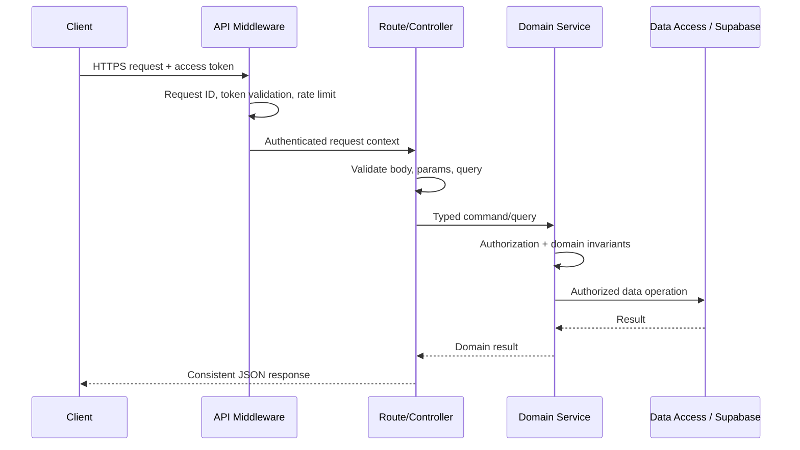
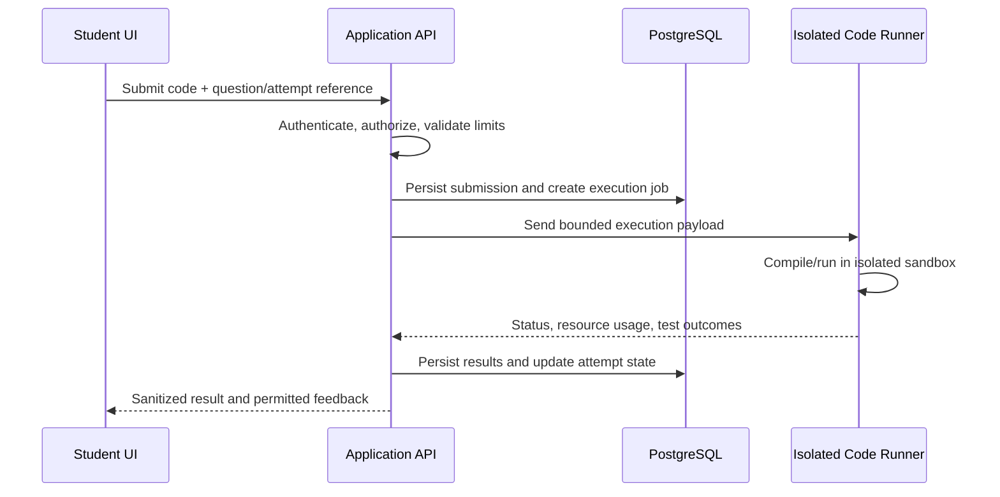
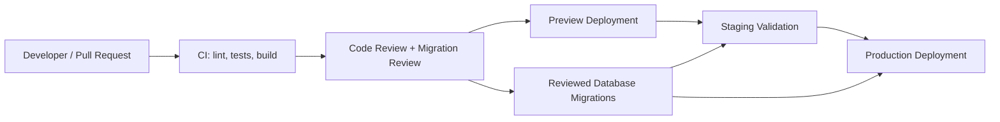

# Adaptive Learning and Assessment Portal — System Architecture

> **Document status:** Proposed baseline architecture  
> **Purpose:** Define the system boundaries, components, data flow, security model, deployment topology, and engineering conventions for implementation.  
> **Authority:** `PRD.md` defines product requirements; `DATABASE.md` defines the authoritative data model and database rules; `AGENT.md` defines coding-agent workflow and implementation constraints. This document defines how the components fit together. If documents conflict, stop and resolve the conflict rather than silently choosing one.

---

## 1. Architecture Overview

The Adaptive Learning and Assessment Portal is a web-based learning and assessment system. It organizes learning material into a prerequisite-aware concept graph, estimates each learner's mastery, recommends the next best learning activity, supports quizzes and coding assessments, and gives students and trainers explainable progress information.

The baseline architecture uses a **modular monolith for the application API**, with external managed services for identity/data storage, AI inference, and code execution. This keeps early development straightforward while preserving clear domain boundaries that can be separated later if scale requires it.

### Architectural goals

- Deliver a responsive experience for students, trainers, and administrators.
- Keep product rules and authorization in the backend, not in the browser.
- Make learning recommendations explainable and reproducible.
- Keep generated content reviewable and versioned before publication where required.
- Protect assessment answers, hidden test cases, private evaluation data, and learner records.
- Isolate untrusted code execution from the application server.
- Preserve useful evidence for debugging, assessment review, and integrity decisions.
- Support incremental delivery without introducing premature microservices.

### High-level component diagram

```mermaid
flowchart TB
    Browser[Web Browser]
    UI[React + Vite (JavaScript) UI]
    API[Node.js + Express (JavaScript) API]
    Auth[Supabase Auth]
    DB[(Supabase PostgreSQL)]
    Storage[Supabase Storage]
    AI[AI Provider / LLM]
    Retrieve[Retrieval and Context Builder]
    Queue[Background Job Runner]
    Judge[Judge0 or Isolated Code Runner]
    Monitor[Logs, Metrics and Error Reporting]

    Browser --> UI
    UI -->|HTTPS REST + access token| API
    UI -->|Auth flow| Auth
    API -->|Validate identity / JWT claims| Auth
    API -->|Authorized queries| DB
    API -->|Signed upload/download URLs| Storage
    API --> Retrieve
    Retrieve --> DB
    Retrieve --> Storage
    API -->|Enqueue long-running work| Queue
    Queue --> AI
    Queue --> DB
    API -->|Submit code job| Judge
    Judge -->|Execution result| API
    API --> Monitor
    Queue --> Monitor
```

**Trust boundaries:** the browser is untrusted; the API is the application policy boundary; Supabase RLS is a second data-access boundary; AI providers and code execution services are external processing boundaries. Never treat client-side state, submitted role names, generated AI output, or student code as trusted.

---

## 2. Technology Baseline

| Layer | Baseline | Responsibility |
|---|---|---|
| Web client | React, Vite, JavaScript, Tailwind CSS | Screens, forms, learning experience, dashboards, assessment UI |
| Code editor | Monaco Editor | Coding questions, editing, and supported replay/event capture |
| Charts | Recharts or an equivalent approved charting library | Mastery, progress, and assessment visualizations |
| Application API | Node.js, Express, JavaScript | Authentication enforcement, domain rules, validation, orchestration, REST endpoints |
| Identity | Supabase Auth | Sign-in, sessions, token issuance, password/OAuth flows as configured |
| Relational data | Supabase PostgreSQL | Durable product data, versioned content, attempts, mastery, recommendations, audit evidence |
| File storage | Supabase Storage | Syllabus documents and approved learning assets; private by default where appropriate |
| AI | Configurable LLM provider | Content drafting, explanations, question generation, and AI viva support |
| Retrieval | PostgreSQL queries and/or approved retrieval index | Ground AI responses in authorized course material and source evidence |
| Code evaluation | Judge0 or a separately isolated executor | Compile/run student code under resource and network limits |
| Hosting | Vercel or another approved static frontend host; API host selected for Node workloads | Frontend delivery and API runtime |
| Background processing | Separate worker process or durable job runner | Long-running AI, document processing, and asynchronous evaluation tasks |

The exact AI provider, queue technology, hosting provider, and retrieval implementation are configuration/implementation decisions. Do not hard-code a vendor into domain logic.

---

## 3. Application Structure

### 3.1 Frontend responsibilities

The frontend should:

- Render role-aware routes and user interfaces.
- Collect input and perform immediate usability validation.
- Call the API through a shared typed API client.
- Display loading, empty, success, and error states consistently.
- Present learning recommendations with their rationale when supplied by the backend.
- Display generated content only according to its publication/review status.
- Send code and permitted editor-session events to the backend; never evaluate code locally as the authoritative grade.
- Avoid embedding service-role keys, AI provider keys, database credentials, hidden answers, or hidden tests.

The frontend may hide controls based on role for usability, but this is **not authorization**. Every protected API operation must independently verify identity, role, ownership, and resource state.

### 3.2 Backend modular monolith

Organize the API into domain modules with explicit boundaries. Suggested structure:

```text
project-root/
├── apps/
│   ├── web/                         # React + Vite client
│   ├── api/                         # Express API
│   └── worker/                      # Optional background worker
├── packages/
│   ├── shared-types/                # Shared request/response contracts only
│   └── validation/                  # Shared schema definitions where appropriate
├── supabase/
│   ├── migrations/                 # Ordered, reviewed SQL migrations
│   ├── seed.sql                    # Development/test seed data only
│   └── config.toml                 # Supabase local configuration if used
├── docs/
│   ├── PRD.md
│   ├── ARCHITECTURE.md
│   ├── DATABASE.md
│   ├── AGENT.md
│   └── API_SPEC.md                 # Add when API contracts are defined
├── .env.example
└── README.md
```

This is a recommended layout, not a requirement to reorganize an existing repository immediately. If the repository already uses another structure, preserve it unless a deliberate migration is approved.

Suggested API module layout:

```text
src/
├── app.js
├── server.js
├── config/
├── middleware/       # auth, validation, errors, rate limits, request IDs
├── modules/
│   ├── identity/
│   ├── courses/
│   ├── syllabus/
│   ├── concepts/
│   ├── resources/
│   ├── generation/
│   ├── questions/
│   ├── assessments/
│   ├── attempts/
│   ├── mastery/
│   ├── recommendations/
│   ├── coding/
│   ├── integrity/
│   ├── viva/
│   └── analytics/
├── integrations/    # Supabase, AI provider, storage, code runner
├── jobs/             # Job handlers and retry-safe workers
├── shared/           # errors, logger, IDs, utilities
└── tests/
```

Each module should contain its route/controller, input schema, service/domain logic, and data-access code. Keep controllers thin. Domain services enforce business rules; integration adapters isolate vendor-specific APIs; repositories/data-access functions keep queries and persistence concerns organized.

### 3.3 Request lifecycle



Use centralized error handling and a consistent response envelope. Never return stack traces, SQL details, provider secrets, hidden answers, or private evaluation payloads to the client.

---

## 4. Core Domain Components

### 4.1 Identity, roles, and course access

- Supabase Auth handles authentication.
- The API validates the caller's access token and derives the authenticated user ID from verified claims.
- The application stores profile and role-related data according to `DATABASE.md`.
- Course enrollment, trainer assignment, and administrative permissions determine resource access.
- Never trust a `userId`, `role`, `courseId`, or `ownerId` supplied by the browser without checking it against the authenticated principal and database state.
- Prevent self-service role escalation. Privileged role changes require a protected administrative workflow.

### 4.2 Syllabus ingestion and concept graph

1. A trainer uploads a syllabus or enters syllabus content.
2. The API checks file type, size, ownership, and upload authorization; private files remain private.
3. A background job extracts and normalizes text from supported formats.
4. The generation pipeline proposes modules, concepts, objectives, and prerequisite edges.
5. The backend validates structure, duplicate concepts, and prerequisite cycles.
6. A trainer reviews and edits the proposal before it becomes an approved/published course version.
7. The published syllabus version becomes the stable reference for resources, questions, and learner progress.

AI output is a draft, not an authoritative database update. Store generation status, source references, errors, and version linkage. Reject cyclic prerequisite graphs or require explicit correction before publication.

### 4.3 Learning resources and AI generation

- The API builds prompts from authorized course material, learning objectives, learner level, and relevant concept context.
- Retrieval must enforce course/user permissions before material is added to a prompt.
- Generated explanations, examples, and questions must be schema-validated and checked for completeness and policy constraints.
- Record provenance/source references where supported so users can inspect the evidence behind an explanation or generated item.
- Use asynchronous jobs for long-running generation, with visible states such as `queued`, `processing`, `needs_review`, `published`, `failed`, and `cancelled` where appropriate.
- Use idempotency keys or deduplication rules to prevent accidental duplicate jobs from retries.
- Keep provider-specific request/response formats inside integration adapters.

### 4.4 Question bank and assessment delivery

- Question identities and question versions are separate; published versions should be immutable.
- Assessments reference explicit question versions and preserve the intended assessment configuration.
- The backend controls attempt creation, timing, submission windows, scoring, and finalization.
- The browser receives only the question data required for the active attempt.
- Answer keys, rubrics used for private grading, hidden coding tests, and private evaluation metadata must remain server-side.
- Enforce attempt-state transitions on the server; repeated submissions must be handled idempotently where appropriate.
- For objective questions, grade using trusted backend logic. For AI-assisted grading, apply schema validation, evidence requirements, confidence/review thresholds, and human review where required by the PRD.

### 4.5 Adaptive mastery and recommendation engine

Treat mastery estimation and recommendation selection as a domain service, separate from UI components and LLM output.

Inputs may include:
- Current mastery estimate and its model/version.
- Concept prerequisites and course version.
- Recent answers, correctness, difficulty, attempts, and time/evidence features permitted by the product rules.
- Learning objectives and available approved resources/questions.

Processing:
1. Record assessment evidence as an append-only event where the schema requires it.
2. Update the learner's current mastery state using the selected model (for example, BKT if specified by the product configuration).
3. Preserve a history of changes, model/configuration version, and relevant evidence references.
4. Generate recommendations only from approved resources and eligible questions.
5. Return a concise reason, such as a prerequisite gap, low estimated mastery, recent error pattern, or recommended review interval.

Do not let an LLM independently invent or overwrite mastery scores. Recommendations should be reproducible from stored state and configuration where possible. Avoid implying that mastery estimates are perfectly certain; expose appropriate uncertainty and evidence.

### 4.6 Coding assessment and execution



Security requirements:
- **Never execute student code inside the Express API process or a trusted worker without a dedicated sandbox.**
- Use Judge0 or an equivalent isolated execution service with CPU, memory, wall-clock, process, output, and source-size limits.
- Disable outbound network access unless a reviewed requirement explicitly needs it.
- Keep hidden tests and expected outputs private; only send them to the execution service through a trusted server-side path.
- Do not expose infrastructure details or raw evaluator internals in student-facing responses.
- Apply concurrency limits, per-user quotas, queue backpressure, and timeouts.
- Treat execution output and compiler messages as untrusted input; sanitize before rendering.
- Store execution jobs and results with status, timestamps, and resource usage for troubleshooting and auditability.

### 4.7 Editor replay and integrity evidence

- Capture only events required by the product and communicate the collection purpose to users.
- Store event data in a structured, timestamped form with session/attempt references.
- Limit payload size and redact credentials, unrelated browser data, and other unnecessary personal information.
- Provide replay through a deterministic event sequence where possible; document gaps when events are unavailable.
- Integrity signals are indicators for review, not proof of misconduct.
- Do not automatically punish or invalidate a learner solely from a heuristic signal. Preserve the evidence, record reviewer decisions, and support an appeal/correction workflow if required.
- Restrict access to integrity evidence to authorized roles and log access to sensitive review data.

### 4.8 AI viva

- Generate or select viva questions based on approved course concepts, assessment context, and allowed learner evidence.
- Store questions, answers, evaluation outputs, and evidence references according to the data model and retention rules.
- Validate AI evaluation output against a strict schema; do not trust free-form output as a score without validation.
- Separate model-generated feedback from trainer-confirmed results.
- Apply rate limits, timeout handling, and fallback messaging when the AI provider is unavailable.

### 4.9 Dashboards and analytics

- Student dashboards show progress, mastery trends, completed work, and recommended next steps for the authenticated student.
- Trainer dashboards aggregate data only for assigned courses and authorized learners.
- Admin dashboards use explicit privileged authorization and minimize unnecessary personal data.
- Prefer indexed queries and pre-aggregated views for expensive analytics; do not fetch an entire course's raw event history into the browser.
- Ensure aggregate queries respect the same access boundaries as row-level queries.

---

## 5. Data Architecture and Persistence

`DATABASE.md` is the source of truth for tables, fields, relationships, constraints, and RLS requirements. This section describes persistence principles only.

- Use Supabase PostgreSQL for relational application data.
- Use UUID primary keys and consistent timestamps as defined by the database specification.
- Use foreign keys, check constraints, uniqueness constraints, and indexes to enforce integrity at the database level where appropriate.
- Use reviewed, ordered SQL migrations; never rely on manually editing production schema without a migration record.
- Version course/syllabus content, questions, and assessments so historical attempts retain their original context.
- Keep append-only histories for mastery changes, audit events, and other evidence where the data model requires them.
- Store large source files in Supabase Storage and persist metadata/ownership in PostgreSQL; do not store arbitrary large files directly in relational rows without a deliberate reason.
- Use transactions for operations that must succeed or fail together, such as finalizing an attempt and recording its result.
- Add indexes based on query patterns and verify them with query plans as data volume grows.
- Do not rename or reinterpret database fields independently of `DATABASE.md`; update the schema documentation and migration together.

### Data access modes

1. **User-scoped operations:** use a verified user identity and RLS policies where applicable.
2. **Trusted server operations:** use narrowly scoped server-side access for privileged workflows only; keep secrets in server environment variables and enforce authorization in application code.
3. **Background jobs:** use explicit job identity/context and re-check resource ownership and current state before writing results.
4. **Public content:** expose only explicitly published content intended to be public; default to private.

RLS is a defense-in-depth boundary, not a replacement for application authorization. Any use of a Supabase service-role key bypasses RLS and therefore requires especially strict server-side controls. Never expose this key in the frontend.

---

## 6. API and Integration Conventions

The API is a versioned REST interface over HTTPS. The detailed endpoint catalog belongs in `API_SPEC.md`.

### Endpoint conventions

- Use resource-oriented routes, plural nouns, and predictable HTTP methods.
- Validate path parameters, query parameters, and request bodies at the boundary using typed schemas.
- Use a consistent error shape, for example:

```json
{
  "error": {
    "code": "VALIDATION_ERROR",
    "message": "The request could not be processed.",
    "requestId": "req_example"
  }
}
```

- Do not expose internal exception messages in production responses.
- Use appropriate status codes: `200` for successful reads/updates, `201` for created resources, `202` for accepted asynchronous jobs, `204` for successful no-content operations, `400` for malformed requests, `401` for unauthenticated requests, `403` for forbidden operations, `404` for unavailable/not-visible resources, `409` for state conflicts, `422` for semantically invalid input, and `429` for rate limits.
- Use pagination for lists that can grow; prefer cursor pagination for event histories or high-volume data.
- Use idempotency keys for retry-prone create/submit operations where duplicate processing would be harmful.
- Define DTOs separately from database rows; do not return entire database records by default.

### External integration adapters

Wrap Supabase, AI providers, storage, and code execution in explicit adapters. Each adapter should define timeouts, retries, error mapping, logging/redaction, and tests with mocked provider responses. Retry only transient failures, use exponential backoff with jitter where suitable, and avoid retrying non-idempotent operations without deduplication.

### Asynchronous work

Use a durable job runner/queue for document extraction, large AI generations, and code execution workflows that may outlive a normal HTTP request. Persist job state so the UI can poll or subscribe to status updates. Workers must be retry-safe, observable, and bounded by concurrency and cost limits. If a queue is not implemented in the first release, use a clearly isolated, persisted job abstraction rather than placing long-running work directly in request handlers.

---

## 7. Security and Privacy

Security controls are mandatory, not optional enhancements.

### Authentication and authorization

- Verify Supabase access tokens server-side.
- Use a central authorization layer for role, ownership, enrollment, trainer assignment, and resource-state checks.
- Apply RLS to exposed tables according to `DATABASE.md`.
- Never trust client-provided roles or ownership identifiers.
- Prevent insecure direct object references by checking access to each requested resource.
- Require elevated authorization for course publishing, role changes, private grading data, and integrity reviews.

### Secrets and configuration

- Keep secrets in environment variables or the hosting platform's secret manager.
- Commit `.env.example` with variable names and safe placeholders only.
- Never commit real keys, tokens, service-role secrets, or production data.
- Expose only explicitly public configuration to the Vite client; variables prefixed for client exposure must contain no secrets.
- Rotate compromised credentials and use separate credentials/environments for development, staging, and production.

### Input and output safety

- Validate all input, including uploaded file metadata, AI output, code execution output, and third-party callbacks.
- Apply request-size limits, upload allowlists, rate limiting, and safe error handling.
- Sanitize rendered Markdown/HTML and prevent XSS.
- Use parameterized database queries; never concatenate untrusted input into SQL.
- Configure CORS for known client origins; do not use permissive wildcard origins with credentials in production.
- Use secure cookie/session settings if cookies are used, and follow CSRF protections appropriate to the chosen authentication transport.

### Privacy and retention

- Collect only data needed for learning, assessment, safety, and product operation.
- Document why editor events and integrity evidence are collected and who can view them.
- Apply retention and deletion rules from the product/database requirements.
- Avoid putting raw learner content, tokens, private test cases, or personally identifying information in logs or AI prompts unless necessary and authorized.
- Use synthetic data in development and tests.

---

## 8. Reliability, Observability, and Cost Controls

### Reliability

- Apply explicit timeouts to database, AI, storage, and code-runner calls.
- Make asynchronous jobs retry-safe and idempotent.
- Handle provider outages with graceful errors and retry/recovery states.
- Use bounded concurrency and backpressure for AI and code execution.
- Persist critical state transitions before reporting completion to the client.
- Avoid depending on an in-memory API process for durable job state.

### Observability

Record structured logs with:
- Timestamp, severity, environment, service/module, request ID, and job ID when applicable.
- Operation name, latency, result status, and safe error code.
- User ID only where necessary and permitted; avoid logging sensitive request bodies.

Monitor at minimum:
- API error rate and latency.
- Database latency and connection/pool saturation where visible.
- AI request failures, latency, token/cost usage, and generation review/rejection rate.
- Queue depth, retry count, job age, and dead-letter/failure count.
- Code execution timeouts, failures, resource-limit violations, and queue latency.
- Assessment submission/finalization failures.

Do not log access tokens, passwords, service-role keys, hidden tests, answer keys, or raw private assessment content.

### Cost controls

- Set per-user/course rate limits for AI generation and viva.
- Use token and request budgets; constrain prompts and retrieved context.
- Cache only content that is safe to share across the relevant authorization scope.
- Avoid duplicate generation through deduplication/idempotency.
- Set maximum execution duration and concurrency for code jobs.
- Track provider costs and add alerts before production traffic is enabled.

---

## 9. Deployment Topology

Recommended logical environments:

- **Local:** local frontend/API, Supabase local development or a dedicated development Supabase project, mocked AI/code runner where useful.
- **Preview/Staging:** isolated Supabase project or isolated schema/data, non-production credentials, test AI budget, restricted code runner.
- **Production:** separate credentials and data, protected deployments, backups and recovery procedures, monitoring, least-privilege access.

### Deployment flow



Apply schema changes through ordered migrations. Review destructive changes carefully and use a staged expand/migrate/contract approach when a change could break deployed application versions. Do not automatically run destructive production migrations merely because a branch was deployed.

### Environment variables

Document required variables in `.env.example`. Exact names should be finalized in the implementation and API documentation. Common categories include:

- Public frontend: Supabase project URL and publishable/anon key, API base URL.
- API: Supabase URL and server-side key appropriate to the chosen access pattern, allowed client origins, environment, port, logging configuration.
- AI: provider name, API key, model name, timeout, token/cost limits.
- Code runner: endpoint, authentication credential, timeout/resource defaults.
- Worker/queue: connection details and concurrency settings, if a queue is selected.

Never copy production secrets into local configuration or share them in prompts, logs, screenshots, or documentation.

---

## 10. Testing Strategy

| Test level | What it should verify |
|---|---|
| Unit | Domain rules, mastery updates, recommendation rationale, validation, state transitions |
| API integration | Authentication, authorization, request validation, database behavior, consistent errors |
| RLS/security | Students cannot access another student's private data; trainers are limited to assigned courses; protected keys/tests are inaccessible to clients |
| Workflow integration | Syllabus upload → generation → trainer review → publication; assessment attempt → submission → grading; coding submission → isolated execution → result persistence |
| AI contract tests | Structured output validation, malformed output handling, timeout/retry behavior, evidence/source linkage |
| Execution security tests | Timeouts, resource limits, network isolation, oversized output, malformed payloads, concurrency caps |
| End-to-end | Critical student/trainer flows, responsive UI, assessment completion and dashboard updates |
| Migration tests | Clean database setup, migration order, seed behavior, and compatibility of schema changes |

Use deterministic fixtures and mocked external services for most automated tests. Keep a small, controlled set of integration tests for real provider connections. Never use real hidden tests or production learner data in ordinary test fixtures.

### Definition of ready for release

- Linting, tests, and production build pass.
- Authorization and RLS tests cover affected data paths.
- Database migrations are reviewed and tested from a clean state.
- Error, loading, retry, and empty states exist for the changed workflow.
- Sensitive information is not exposed in client bundles, API responses, or logs.
- New background jobs have timeout, retry, idempotency, and failure handling.
- Documentation is updated where architecture, schema, or API contracts changed.

---

## 11. Recommended Implementation Sequence

The exact release scope is controlled by `PRD.md`. A practical technical sequence is:

1. **Foundation:** repository conventions, environment configuration, shared validation, logging, error handling, CI checks.
2. **Identity and access:** Supabase Auth integration, profiles/roles, course enrollment and trainer assignment, RLS tests.
3. **Course and syllabus:** course versioning, uploads, concept graph, prerequisite validation, trainer approval.
4. **Learning content:** resources, AI generation jobs, source evidence, review/publish workflow.
5. **Question bank and assessments:** question versioning, assessment configuration, attempts, submission, secure grading.
6. **Mastery and recommendations:** evidence capture, mastery service, history, explainable recommendations.
7. **Coding assessments:** isolated executor integration, job tracking, result persistence, quotas and security tests.
8. **Replay, integrity, and viva:** privacy-bounded event capture, review workflows, AI viva and evaluation validation.
9. **Dashboards and hardening:** analytics, accessibility, performance, monitoring, backups, recovery and deployment validation.

Deliver in vertical slices where possible: complete a feature across UI, API, persistence, authorization, tests, and documentation before moving to the next slice.

---

## 12. Architecture Decision Records

Record meaningful changes in `docs/decisions/` using short ADR files. Each ADR should include context, decision, alternatives considered, consequences, date, and status.

The following baseline decisions should be treated as current unless explicitly superseded:

| ID | Decision | Rationale |
|---|---|---|
| ADR-001 | Start with a modular monolith for the application API | Keeps development and deployment manageable while preserving domain boundaries |
| ADR-002 | Use Supabase Auth + PostgreSQL, with RLS and application authorization | Managed identity/data platform with defense-in-depth access control |
| ADR-003 | Keep AI and code-runner integrations behind adapters | Enables provider changes, tests, and consistent failure handling |
| ADR-004 | Run untrusted student code only in a dedicated isolated executor | Protects API, database, and infrastructure from arbitrary code |
| ADR-005 | Version published learning content, questions, and assessments | Preserves the context and reproducibility of historical attempts |
| ADR-006 | Keep mastery computation deterministic/configurable and evidence-backed | Makes learning recommendations explainable and auditable |
| ADR-007 | Treat integrity signals as review evidence, not automatic proof | Reduces false accusations and supports human review |

---

## 13. Rules for Future Architecture Changes

Before introducing a new service, library, database, queue, or provider:

1. Identify the requirement it satisfies and the problem with the current design.
2. Check compatibility with `PRD.md`, `DATABASE.md`, `AGENT.md`, and the API contract.
3. Describe security, privacy, cost, operational, and migration implications.
4. Add or update an ADR for decisions that materially affect system boundaries or data flow.
5. Update environment documentation, tests, and deployment instructions.
6. Avoid unnecessary microservices, duplicate sources of truth, and parallel implementations of the same business rule.

Do not silently change the database schema, role model, mastery algorithm, grading rules, evidence-retention policy, or code-execution boundary. Propose the change and update the authoritative documents first.

---

## 14. Related Documents

- `PRD.md` — product scope, requirements, user journeys, and acceptance criteria.
- `DATABASE.md` — database entities, relationships, constraints, RLS, migrations, and data ownership.
- `AGENT.md` — instructions and workflow for AI coding agents and developers.
- `API_SPEC.md` — planned source of truth for REST endpoints, request/response schemas, status codes, and error contracts.
- `README.md` — setup, local development, testing, environment configuration, and deployment commands.

**Implementation rule:** Read the relevant documents before coding. If a required behavior or design decision is missing, document the assumption or ask for clarification rather than inventing a conflicting contract.
