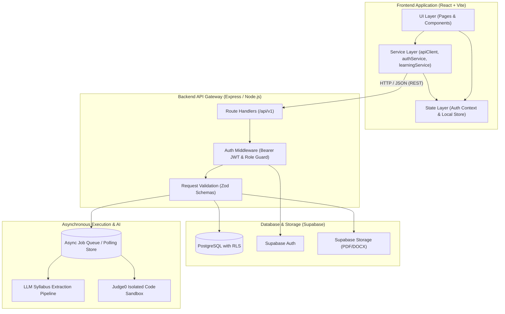
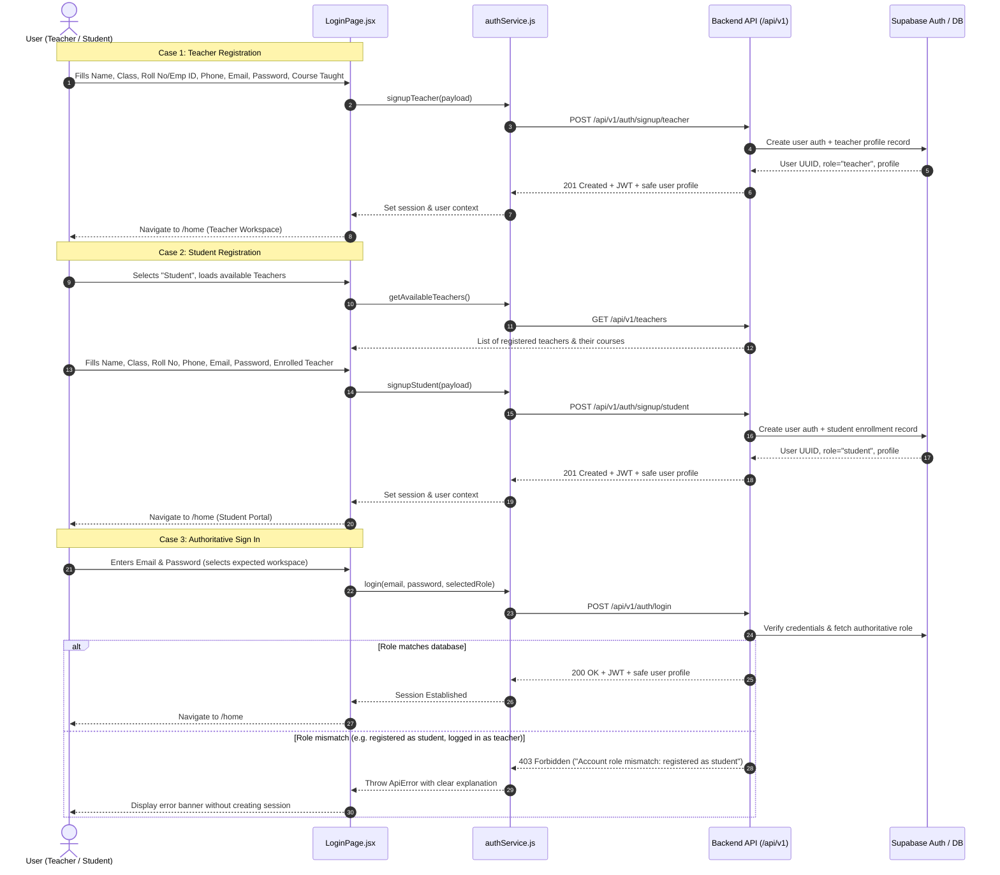
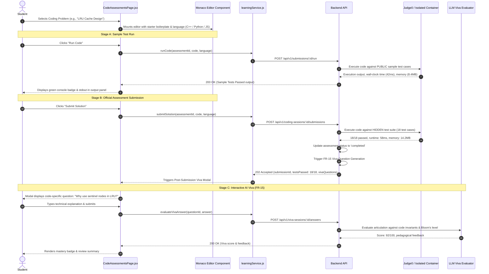

# Frontend Flow and API Integration Architecture — Pathwise

**Document Status:** Approved Implementation Specification  
**Version:** 2.0.0  
**Last Updated:** 2026-10-16  
**Audience:** Frontend Developers, Backend Engineers, Fullstack Integrators, AI Agents, and QA  

---

## 1. System Architectural Overview

Pathwise is an adaptive learning and assessment portal featuring a role-aware React frontend, a RESTful Express/Node.js backend, Supabase (PostgreSQL, Auth, Storage, RLS), and asynchronous AI/execution engines (LLM Syllabus Extraction and Judge0 Isolated Code Sandbox).

### 1.1 High-Level Architecture Diagram



### 1.2 Frontend Architecture Layering

1. **Presentation Layer (`client/src/pages/`, `client/src/components/`):**
   - Pure UI and container components styled with the modern Studdy-inspired aesthetic (`#EEF3FB` soft canvas, `22px` rounded cards, pill navigation, vibrant badges).
   - Component tree structured around `AppShell`, `Sidebar`, `Topbar`, role-based routes, and feedback states (`LoadingState`, `EmptyState`, `ErrorState`).
2. **Context & Hook Layer (`client/src/hooks/useAuth.js`):**
   - Manages active user identity, authoritative role (`student` vs `teacher`), session status, and login/logout methods.
   - Provides route guards (`ProtectedRoute`, `PublicRoute`) that prevent unauthorized view flashes.
3. **Service Layer (`client/src/services/`):**
   - `apiClient.js`: Centralized HTTP fetch wrapper configured with base URL, standard request headers, HttpOnly credentials support, JSON safety parsing, and normalized error throwing (`ApiError`).
   - `authService.js`: Implements login, teacher registration, student registration, role validation, session restoration, and user directory retrieval.
   - `learningService.js`: Implements course fetching, concept hierarchy traversal, quiz attempts, sandbox code running, final submission, AI viva grading, student mastery updates, and teacher reviews.
4. **Mock / Fallback Layer (`client/src/services/mockData.js`):**
   - Seeded database fixtures providing offline resilience, interactive demo data, and instant mock state persistence across browser reloads via `localStorage`.

---

## 2. Authentication & User Lifecycle Flow

Authentication is server-authoritative. The client never grants permissions based solely on user selection.

### 2.1 Role-Based Registration & Login State Machine



### 2.2 Session Initialization on Refresh
When the application mounts (`App.jsx` $\rightarrow$ `AuthProvider`):
1. `useAuth` triggers `authService.checkSession()`.
2. The client makes a `GET /api/v1/me` request using the stored Bearer token (or cookie).
3. The server validates the token against Supabase and returns the active profile and authoritative role.
4. If valid, `user` and `role` are initialized, and the requested protected route renders.
5. If invalid (401 or token expired), the session is cleared and the user is redirected to `/login`.

---

## 3. Student Workflow & Backend Interactions

### 3.1 Student Route & Component Hierarchy

```
/home                   --> HomePage.jsx (Welcome hero, mascot, stats, schedule, homework progress)
/dashboard              --> DashboardPage.jsx (Course list, overall progress, concept mastery summary)
/content (Parent Pill)
  ├── /content/concepts --> ConceptsPage.jsx (Acyclic concept tree, modules, learning content modal)
  ├── /content/quizzes  --> QuizPage.jsx (Concept-linked quizzes, timed attempt modal, instant score)
  └── /content/coding   --> CodeAssessmentsPage.jsx (Monaco editor, run sample tests, submit, viva modal)
/progress               --> ProgressPage.jsx (BKT mastery breakdown, evidence count, attempt logs)
/profile                --> ProfilePage.jsx (View/update contact info, read-only academic details)
```

### 3.2 Student Home & Dashboard Data Hydration
When a student visits `/home` or `/dashboard`:
- **Requests Fired:**
  - `GET /api/v1/me`: Returns student profile, class, roll number, assigned teacher, and enrolled course.
  - `GET /api/v1/me/mastery`: Returns student concept breakdown, overall mastery percentage, and BKT confidence.
  - `GET /api/v1/me/recommendations`: Returns AI-recommended next concept and reasoning.
  - `GET /api/v1/me/enrollments`: Returns enrolled courses and current completion rate.
- **Data Synchronization:**
  - Component renders loading skeletons (`LoadingState`).
  - Values populate the Studdy-style metric cards: Attendance (`1/1`), Homework (`0/10`), Rating (`70%`), Timetable schedule, and Next Recommended Step.

### 3.3 Quiz Attempt & Assessment Flow

```mermaid
sequenceDiagram
    autonumber
    actor Student
    participant QP as QuizPage.jsx
    participant LS as learningService.js
    participant API as Backend API
    participant DB as Supabase DB

    Student->>QP: Clicks "Start Quiz" on Concept Quiz
    QP->>LS: getQuizById(quizId)
    LS->>API: POST /api/v1/assessments/:id/attempts
    API->>DB: Create attempt (status: 'in_progress', startedAt: NOW())
    API-->>QP: 201 Created (attemptId, questions with stripped answer keys)
    QP-->>Student: Renders timed quiz modal with question progress

    loop Answer Selection
        Student->>QP: Selects Option B for Question Q1
        QP->>LS: Saves answer locally
        QP->>API: PUT /api/v1/attempts/:id/answers/:qId (Autosave payload)
        API-->>QP: 200 OK (answer recorded)
    end

    Student->>QP: Clicks "Submit Quiz"
    QP->>QP: Checks unanswered questions; shows warning if any missing
    QP->>LS: submitQuizAttempt(quizId, answers)
    LS->>API: POST /api/v1/attempts/:id/submit
    API->>DB: Grade answers server-side, calculate score, mark 'completed'
    API->>DB: Update student_mastery (Bayesian Knowledge Tracing formula)
    API-->>LS: 200 OK (score, passed, explanations, updated mastery)
    LS-->>QP: Updates UI state to 'Result View'
    QP-->>Student: Displays final percentage, pass/fail badge, explanations
```

### 3.4 Coding Assessment & Execution Sandbox Flow
Coding assessments require strict sandboxing. Untrusted student code is never executed in the Express server.



---

## 4. Teacher Workflow & Backend Interactions

### 4.1 Teacher Route & Component Hierarchy

```
/home                       --> HomePage.jsx (Instructor dashboard banner, lecture timetable, quick stats)
/dashboard                  --> DashboardPage.jsx (All students progress, individual mastery levels matrix)
/teacher/content-upload     --> TeacherContentUploadPage.jsx (Syllabus upload, LLM extraction, review & publish)
/teacher/student-progress   --> TeacherStudentProgressPage.jsx (Cohort analytics, mastery distribution, interventions)
/profile                    --> ProfilePage.jsx (Instructor credentials, department info, assigned course)
```

### 4.2 Content Uploading & LLM Extraction Pipeline
The teacher uploads a syllabus (PDF, DOCX, or text) to generate structured curriculum items.

```mermaid
sequenceDiagram
    autonumber
    actor Teacher
    participant TCUP as TeacherContentUploadPage.jsx
    participant API as Backend API
    participant Storage as Supabase Storage
    participant LLM as LLM Agent Pipeline
    participant DB as Database (Course & Concept Tables)

    Teacher->>TCUP: Uploads PDF / pastes text syllabus
    Teacher->>TCUP: Clicks "Extract Curriculum via AI"
    TCUP->>API: POST /api/v1/courses/:courseId/syllabus/imports (multipart/form-data)
    API->>Storage: Store original document
    API->>API: Enqueue Extraction Job in JobQueue
    API-->>TCUP: 202 Accepted (jobId: "job_9841", status: "queued")

    loop Async Polling (every 800ms with progress update)
        TCUP->>API: GET /api/v1/syllabus-imports/job_9841
        API-->>TCUP: 200 OK (progress: 35% -> 65% -> 85% -> 100%, status: "running" | "succeeded")
        TCUP-->>Teacher: Updates visual multi-stage progress bar and status text
    end

    Note over LLM, DB: Pipeline Extracted Artifacts:
    Note over LLM, DB: 1. Acyclic Concept Graph (nodes, edges, prerequisites)
    Note over LLM, DB: 2. Concept-linked Quizzes (options, distractors, explanations)
    Note over LLM, DB: 3. Coding Assessments (constraints, sample & hidden tests)

    API-->>TCUP: Extraction payload with draft concepts, quizzes, and coding tasks
    TCUP-->>Teacher: Displays Review Workspace with 3 interactive tabs:
    Note over Teacher, TCUP: Tab 1: CONCEPTS (Prerequisites, Objectives)
    Note over Teacher, TCUP: Tab 2: QUIZZES ON THAT CONCEPT (Prompts, Correct Answers, Explanations)
    Note over Teacher, TCUP: Tab 3: CODING ASSESSMENTS (Difficulty, Invariants, Test Cases)

    Teacher->>TCUP: Inspects items, edits fields if required, clicks "Approve & Publish to Curriculum"
    TCUP->>API: POST /api/v1/courses/:courseId/publish
    API->>DB: Atomic write: Insert concepts, prerequisite edges, quizzes, and coding tasks
    API-->>TCUP: 200 OK (Published successfully)
    TCUP-->>Teacher: Shows green publication confirmation banner; items live for students
```

### 4.3 Teacher Dashboard: Student Mastery Roster
When a teacher accesses `/dashboard`:
- `GET /api/v1/trainer/courses/:courseId/students`: Returns all enrolled students.
- **Payload Data Structure:**
  ```json
  {
    "data": [
      {
        "id": "usr_student_1",
        "name": "Aarav Sharma",
        "rollNo": "23CS0104",
        "className": "B.Tech CSE - Section A",
        "overallMastery": 78,
        "status": "On Track",
        "attendance": "9/10",
        "homeworkCompleted": "8/10",
        "conceptMastery": {
          "c_arrays": 88,
          "c_linkedlists": 82,
          "c_hashtables": 79,
          "c_recursion": 62,
          "c_dp": 45,
          "c_bst": 71
        }
      }
    ]
  }
  ```
- **Component Rendering:** Renders full-width student roster table, searchable by name/roll number, filterable by mastery status (`Mastered`, `Developing`, `Needs Attention`), with direct links to student diagnostic profiles.

---

## 5. API Endpoint Integration Matrix

The following table defines the binding between frontend components, user actions, service calls, and backend endpoints:

| UI Component | User Action | Service Method | HTTP | Endpoint | Status | Description |
|---|---|---|---|---|---|---|
| `LoginPage.jsx` | Submit Teacher Signup | `authService.signupTeacher` | `POST` | `/api/v1/auth/signup/teacher` | `201` | Registers teacher with course taught |
| `LoginPage.jsx` | Fetch Teachers | `authService.getAvailableTeachers` | `GET` | `/api/v1/teachers` | `200` | Populates teacher/course select list |
| `LoginPage.jsx` | Submit Student Signup | `authService.signupStudent` | `POST` | `/api/v1/auth/signup/student` | `201` | Registers student & links to teacher |
| `LoginPage.jsx` | Submit Login | `authService.login` | `POST` | `/api/v1/auth/login` | `200` | Verifies credentials & returns role |
| `App.jsx` | App Mount / Refresh | `authService.checkSession` | `GET` | `/api/v1/me` | `200` | Validates session & returns profile |
| `Topbar.jsx` | Sign Out | `authService.logout` | `POST` | `/api/v1/auth/logout` | `200` | Clears server cookie & local state |
| `HomePage.jsx` | Page Mount | `learningService.getProgress` | `GET` | `/api/v1/me/progress` | `200` | Loads stats, schedule & next step |
| `DashboardPage.jsx` (Teacher) | Page Mount | `authService.getAllStudents` | `GET` | `/api/v1/trainer/courses/:id/students` | `200` | Fetches roster with mastery levels |
| `DashboardPage.jsx` (Student) | Page Mount | `learningService.getCourses` | `GET` | `/api/v1/me/enrollments` | `200` | Fetches enrolled courses & progress |
| `ConceptsPage.jsx` | Page Mount | `learningService.getAllConcepts` | `GET` | `/api/v1/courses/:id/concepts` | `200` | Retrieves concept graph & modules |
| `QuizPage.jsx` | Start Quiz | `learningService.getQuizById` | `POST` | `/api/v1/assessments/:id/attempts` | `201` | Starts attempt; strips answer keys |
| `QuizPage.jsx` | Select Option | `learningService.saveAnswer` | `PUT` | `/api/v1/attempts/:id/answers/:qId` | `200` | Autosaves individual question answer |
| `QuizPage.jsx` | Submit Quiz | `learningService.submitQuizAttempt` | `POST` | `/api/v1/attempts/:id/submit` | `200` | Evaluates score & updates mastery |
| `CodeAssessmentsPage.jsx` | Run Code | `learningService.runCode` | `POST` | `/api/v1/submissions/:id/run` | `200` | Executes code against sample cases |
| `CodeAssessmentsPage.jsx` | Submit Solution | `learningService.submitSolution` | `POST` | `/api/v1/coding-sessions/:id/submissions` | `202` | Executes against hidden suite via Judge0 |
| `CodeAssessmentsPage.jsx` | Submit Viva | `learningService.evaluateVivaAnswer` | `POST` | `/api/v1/viva-sessions/:id/answers` | `200` | Evaluates post-submission AI viva |
| `TeacherContentUploadPage.jsx` | Upload Syllabus | `learningService.uploadSyllabus` | `POST` | `/api/v1/courses/:id/syllabus/imports` | `202` | Starts asynchronous LLM extraction |
| `TeacherContentUploadPage.jsx` | Poll Status | `learningService.checkImportJob` | `GET` | `/api/v1/syllabus-imports/:jobId` | `200` | Polls extraction progress |
| `TeacherContentUploadPage.jsx` | Publish Curriculum | `learningService.publishCurriculum` | `POST` | `/api/v1/courses/:id/publish` | `200` | Publishes extracted concepts & tasks |
| `ProgressPage.jsx` | Page Mount | `learningService.getProgress` | `GET` | `/api/v1/me/mastery` | `200` | Loads concept masteries & BKT metrics |
| `ProfilePage.jsx` | Save Profile | `authService.updateProfile` | `PATCH` | `/api/v1/me` | `200` | Updates user-editable fields |

---

## 6. Standard API Contract Envelopes

Every network request going through `apiClient.js` adheres to standard JSON envelopes:

### 6.1 Successful Single Resource Envelope (`200 OK`, `201 Created`)
```json
{
  "data": {
    "id": "c_hashtables",
    "name": "Hash Tables & Collision Resolution",
    "masteryLevel": 79,
    "status": "Mastered"
  },
  "meta": {
    "requestId": "req_019a84b2c1"
  }
}
```

### 6.2 Successful Paginated Collection Envelope (`200 OK`)
```json
{
  "data": [
    { "id": "usr_student_1", "name": "Aarav Sharma", "mastery": 78 }
  ],
  "pagination": {
    "limit": 20,
    "nextCursor": "cursor_ey...",
    "hasMore": false
  },
  "meta": {
    "requestId": "req_019a84b2c2"
  }
}
```

### 6.3 Asynchronous Job Envelope (`202 Accepted`)
```json
{
  "data": {
    "jobId": "job_llm_extract_9841",
    "status": "queued",
    "progress": {
      "percentage": 10,
      "step": "Analyzing syllabus structure"
    },
    "statusUrl": "/api/v1/syllabus-imports/job_llm_extract_9841"
  },
  "meta": {
    "requestId": "req_019a84b2c3"
  }
}
```

### 6.4 Error Envelope (`400`, `401`, `403`, `404`, `422`, `429`, `500`)
```json
{
  "error": {
    "code": "ROLE_MISMATCH",
    "message": "Account role mismatch: Your account is registered as 'student'. You cannot sign in as 'teacher'.",
    "details": [
      {
        "field": "role",
        "issue": "Forbidden role access"
      }
    ]
  },
  "meta": {
    "requestId": "req_019a84b2c4"
  }
}
```

---

## 7. State Management, Resilience & Security Rules

### 7.1 Authoritative Security Rules
1. **No Client Role Promotion:** The frontend role state is derived exclusively from the verified JWT payload returned by the server. If a client attempts to access `/teacher/content-upload` without a verified `teacher` role, `ProtectedRoute` intercepts and redirects to `/home`.
2. **Hidden Test & Answer Protection:** The backend must never send correct answer indices (`correctIndex`), hidden unit tests, or reference solutions in student assessment payloads. Grader evaluation is strictly executed server-side.
3. **Sensitive Key Isolation:** LLM API keys (Gemini / OpenAI), Judge0 execution secrets, and Supabase service-role keys must never be exposed in client code or Vite environment variables (`VITE_*`).

### 7.2 Asynchronous Polling Strategy
When interacting with long-running jobs (LLM Syllabus Extraction and Judge0 Code Submissions):
- Use bounded exponential backoff with jitter: initial delay 800ms, multiplier 1.5, max delay 4000ms.
- Maximum poll duration: 60 seconds.
- Cancellation: If the user navigates away from the page, an `AbortController` signal cancels pending requests to avoid dangling memory leaks.

### 7.3 Offline Resilience & Demo Mode
- `apiClient.js` gracefully handles network disconnections by reporting informative `ApiError` instances.
- For interactive demonstration and rapid development, `mockData.js` coupled with `localStorage` guarantees that newly signed-up teachers, students, uploaded syllabi, quiz submissions, and viva answers persist across browser refreshes without data loss.
